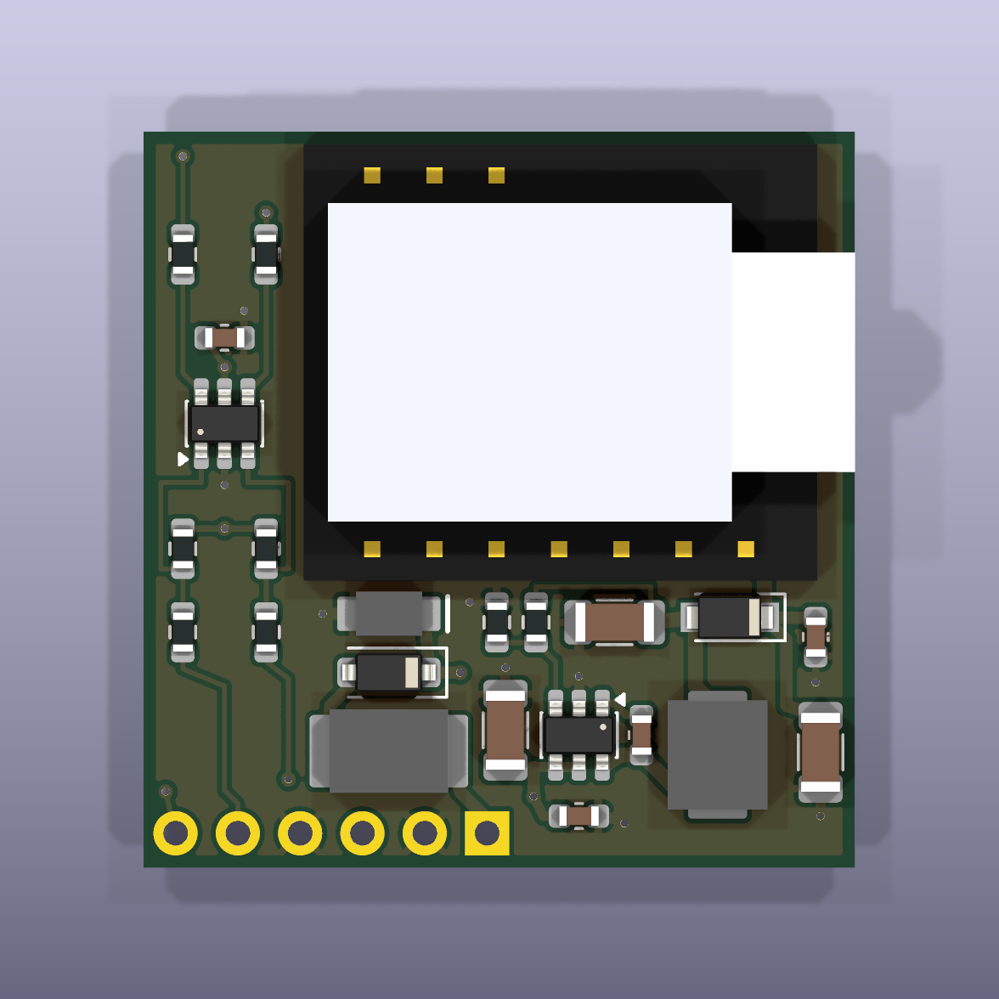

# SolArk XIAO tap carrier, Rev B-diy (2026-10-13)

This is a small 4-layer carrier PCB. It replaces the hand-wired protoboard in
[`../../docs/hardware/README.md`](../../docs/hardware/README.md) and holds:
- a XIAO ESP32S3 Plus, soldered on header pins;
- a 12 V to 5 V buck regulator with input protection;
- a receive-only Schmitt buffer for the two passive Modbus taps.

The harness is soldered straight to six wire pads (J1). Its in-line plug lives on the harness.

This is the **hand-soldered, lowest-cash variant**. Every fitted part is 0603 or larger, with leaded or visible terminations.
- Recommended build: OSH Park 4-layer bare boards, with every part hand-soldered from Digi-Key. Costs are in `PRICING.md`.
- Changes from Rev A: `CHANGES-revB.md`.
- Unresolved items: `OPEN-ITEMS.md`.

Status: **design complete, not ordered.**
- `sh scripts/build.sh` exits 0.
- ERC reports 0 violations; DRC reports 0 violations, 0 unconnected items and 0 schematic parity issues. Both run at all severities, so warnings count. The reports are `fab/erc.rpt` and `fab/drc.rpt`.

| | |
|---|---|
| Board | **29.0 x 30.0 mm** (x along the J1 edge, y along the USB-C edge), 4 layers, 1.6 mm FR-4 |
| Assembly | Everything hand-soldered. All fitted SMD parts are on the top. The bottom holds only the DNP proxy pads and the header/wire-pad joints. |
| Height | About 7.8 mm (1.0 mm tail + 1.6 mm board + 0.3 mm + 4.9 mm XIAO) against a 9.0 mm limit [I]. Measure before ordering: `OPEN-ITEMS.md` O1. |



Other renders: `fab/render_bottom.png`, `fab/render_side_front.png`, `fab/render_side_right.png` and `fab/render_iso.png`.

## !! J1 OFF FOR USB !!

**Unsolder or unplug the harness (J1) before connecting USB-C to the XIAO.** This rule is also on the bottom silk.
- D2 blocks the XIAO's USB 5 V from reaching the buck.
- USB still ties the laptop's ground to the inverter ground through J1.
- Flash and debug the XIAO on the bench, with the harness unplugged at its in-line connector.

## Files

| Path | What |
|---|---|
| `carrier.kicad_pro` / `.kicad_sch` / `.kicad_pcb` | KiCad 10 project. Every DRC minimum (ring, clearance, track, hole, hole to hole, edge) is the stricter of the JLCPCB 4-layer and OSH Park 4-layer published values, so a clean DRC holds for either fab. |
| `scripts/design.py` | **Single source of truth**: parts, values, sources (Digi-Key/LCSC), the hand kit, DNP flags, nets and the VBUS tolerance inputs |
| `scripts/gen_lib.py` | Project symbols and footprints: XIAO header footprint, J1 wire pads, TI DBV0006A, Bourns SRP4020TA and MF-MSMF lands, box 3D models |
| `scripts/gen_sch.py`, `gen_pcb.py`, `routes.py` | Schematic; placement, routing, pours, silk and stackup |
| `scripts/build.sh` | Full regeneration, ERC, DRC (fails on any violation) and all fab exports |
| `tests/` | Design and board invariants (run `../../tools/.venv/bin/pytest -q tests`) |
| `fab/carrier_gerbers.zip` | Gerbers, drill file and job file. This is the file you upload to OSH Park or JLC. |
| `fab/carrier_bom_digikey.csv` | Digi-Key order for every fitted part, plus the header pins, the harness plug and the 2 harness 10 k resistors (rows marked `kit`) |
| `fab/carrier_bom_jlc.csv`, `fab/carrier_cpl_jlc.csv` | Only for route (a), JLC Economic placing the Basic parts. See `PRICING.md`. |
| `fab/carrier_schematic.pdf` | Schematic |

The generator overwrites the KiCad files. To change the design, edit `scripts/design.py` (and `routes.py` for copper), never the KiCad files.

## Circuit

```
J1.1 +12V -> F1 PPTC 0.5A/60V (1812) -> D1 B5819W -> +12V_P [TVS1 SMF18A, C1 10uF/50V, C2 100nF]
  -> U2 LMR51610 (EN = VIN, 1.1 MHz) -> L1 SRP4020TA 10uH -> +5V_BUCK [C7 22uF/25V, R13 20.5k / R14 3.83k 0.1 %]
  -> D2 PMEG4030ER (backfeed block) -> +5V_X [C3 100uF, C4 100nF] -> XIAO 5V (pin 14)

J1.5 TAP pad 9  (inverter replies) -> R3 1k -> U3 1A [R5 100k to 3V3] -> U3 1Y -> R7 1k -> XIAO D0/GPIO1 (pin 1)
J1.6 TAP pad 10 (dongle requests)  -> R4 1k -> U3 2A [R6 100k to 3V3] -> U3 2Y -> R8 1k -> XIAO D1/GPIO2 (pin 2)
U3 SN74LVC2G17 on XIAO 3V3 [C9 100nF]
XIAO D9/GPIO8 (pin 10) -> R12 1k DNP -> JP1 open jumper -> TP1 pad   (bottom, "DNP: proxy only")
```

**Receive only.**
- The XIAO GPIOs see only U3's outputs. The taps see only U3's inputs and the series resistors.
- No path through fitted parts lets the board drive the tapped lines.
- U3 has Ioff, so a powered-down board does not load the link.
- The off-board 10 k resistors in the harness are **required** (kit item CF18JT10K0). Board B has no ESD diodes; that is acceptable only with these 10 k in series at the dongle end of each tap wire.
- `tests/test_design.py` enforces all of this.

**Bias.**
- R5/R6 hold the buffer inputs high when the harness is unplugged.
- A tap low gives 0.33 V at the U3 input, below VT− min of 0.8 V. A tap high gives about 3.3 V, above VT+ max of 2.0 V.

**Vout.** 0.8 x (1 + 20.5/3.83) = 5.08 V nominal, 4.985-5.180 V worst case. The XIAO pin sees 4.485-5.180 V after D2 (arithmetic in `CHANGES-revB.md`).

**J1 wire pads**: 6 plated holes, 1.0 mm drill and 1.8 mm pads, on 2.54 mm pitch along the bottom edge. Pin 1 has the square pad.

| Pin | Signal |
|---|---|
| 1 | +12 V |
| 2 | GND (power) |
| 3 | spare, NC |
| 4 | GND (signal) |
| 5 | TAP pad 9 (inverter replies) |
| 6 | TAP pad 10 (dongle requests) |

The harness:
- **Required: one 10 k series resistor in each tap wire** (Stackpole CF18JT10K0, 1/8 W axial, Digi-Key CF18JT10K0CT-ND, in the kit). Solder it at the **dongle-pad end**: one at dongle pad 9 (J1.5 wire) and one at dongle pad 10 (J1.6 wire), heat-shrunk. They are not optional: they are the ESD and fault limit on the tap lines, since Board B has no D3/D4 diodes. Without them, do not connect the harness.
- Solder 6 short wires (26-24 AWG) into J1.
- Break a **6-pin section off a PRPC040 strip, keeping its plastic**, and solder the free ends of the 6 J1 wires to its short tails. Heat-shrink each joint. This half stays with the carrier.
- It mates with the Sullins PPTC061LFBN-RC 6-way female housing. Solder the dongle-side wires to the housing's tails.
- Keep the inline fuse at the DB9 end, because F1 does not protect the harness itself.

The wire bend leaves the J1 edge, past the board outline (O2).

## XIAO mount

The XIAO is soldered on **Sullins PRPC040SAAN-RC** 0.64 mm square header pins (break off 2 x 7).
- The carrier holes are drilled 1.10 mm, which is 1.02-1.23 mm finished at JLC's +0.13/−0.08 tolerance and tighter at OSH Park's.
- The worst-case pin diagonal is 0.933 mm.
- The castellation pads are gone. The 1.45 mm top ring clears the Plus's bottom pads 15-23 by 0.174 mm.
- **The XIAO is not removable.** Desoldering 14 pins is possible but rough on the board.

## Hand-assembly order

You need:
- a temperature-controlled iron with a fine conical tip and a 2-3 mm chisel tip;
- flux, 0.5 mm solder, tweezers and solder wick;
- a magnifier;
- optionally, hot air.

Work from the smallest, flattest parts to the tallest. Keep the hot-air nozzle away from finished 0603s.

1. **U3, U2 (SOT-23-6), iron, fine tip.** Tack one corner pin, check alignment and **pin 1** against the silk dot and the render, then solder the rest. Wick any bridges.
2. **0603 resistors and capacitors, iron, fine tip.**
   - The R3-R8 columns are on the left; R13/R14 and C8 sit by U2.
   - **R13 = 20.5k and R14 = 3.83k are the 0.1 % parts.** Do not swap them with the 1 % strip.
3. **Diodes, iron. Check the polarity band against the silk before soldering.**
   - D1 B5819W (SOD-123) and TVS1 SMF18A (SOD-123FL) sit in the left protection stack.
   - D2 PMEG4030ER (CFP3) sits next to the USB edge.
4. **1206 capacitors C1, C3, C7, iron, chisel tip.** These need more heat.
5. **F1 1812 PPTC, chisel tip.**
6. **L1 SRP4020TA.** Use the chisel tip with plenty of heat on each terminal, or hot air at about 350 °C. Its pads extend past the body, so an iron works.
7. **Clean the flux and inspect** under magnification.
8. **Power test, no XIAO.**
   - Feed 12 V into J1 pin 1 (+) and pin 2 (−) from a supply limited to **100 mA**.
   - Expect under about 10 mA idle.
   - Expect 4.99-5.18 V at C7 and 4.8-5.18 V at C3 (XIAO pin 14). With no load, D2 drops only about 0.1-0.2 V.
   - Swap the polarity: there should be no current, because D1 blocks it.
9. **Header pins and XIAO.**
   - Insert the 2 x 7 header strips into the XIAO and seat them on the carrier.
   - Solder the XIAO side first, then the carrier side from the bottom.
   - **Pull off the black plastic spacer** (it would add 2.5 mm). The XIAO should sit about 0.3 mm above the board.
   - Trim the tails to about 1.0 mm below the board.
   - USB-C goes at the edge marked "USB".
10. **Re-check 5 V at XIAO pin 14** with the XIAO running.
11. **Harness.** Solder the 6 wires into J1 per the pin table and fit the in-line plug. Fit the two **required** 10 k resistors at the dongle-pad ends of the J1.5 and J1.6 wires. Check continuity (dongle pad 9 to J1.5 and pad 10 to J1.6 read 10 k) and that there is no 12 V to tap short before connecting to the dongle.

## Verified vs inferred

**Verified** from primary sources or tool output on 2026-10-13, and for C3, the harness 10 k and the fab rules on 2026-10-14. URLs are in `CHANGES-revB.md`.
- ERC, DRC and parity are clean.
- Every fitted part:
  - is in stock at Digi-Key, with the part number and price;
  - has its land pattern matched to the manufacturer drawing and enforced by `test_land_patterns_match_the_datasheets` (the generic 0603/1206 passives use KiCad's IPC lands; C3's differs from TDK's recommendation);
  - is within its voltage and current ratings.
- LMR51610 pinout, VFB tolerance, current limit and FB divider range (TI).
- SN74LVC2G17 pinout, thresholds and Ioff (TI).
- Sullins PRPC040 pin size and insulator height.
- OSH Park and JLC 4-layer rules (every DRC minimum is the stricter of the two) and the OSH Park price; JLC Economic PCBA fees.
- C3 (TDK C3216X5R0J107M160AB) stock, rating and 5 V bias (about 28.7 µF). Its land is KiCad's 1206, which is not TDK's recommended land (see `CHANGES-revB.md`).
- XIAO pin positions, outline and Plus pad positions, from Seeed's KiCad files.

**Inferred**, still to verify (see `OPEN-ITEMS.md`):
- XIAO Plus total height (4.9 mm) and the stack numbers.
- The USB 4.40 V low-power minimum used for the VBUS floor.
- The PMEG4030ER forward voltage at 0.5 A when cold.
- PPTC hold current at 60 °C.
- The dongle's logic level (assumed 3.3 V; 5 V also works).
