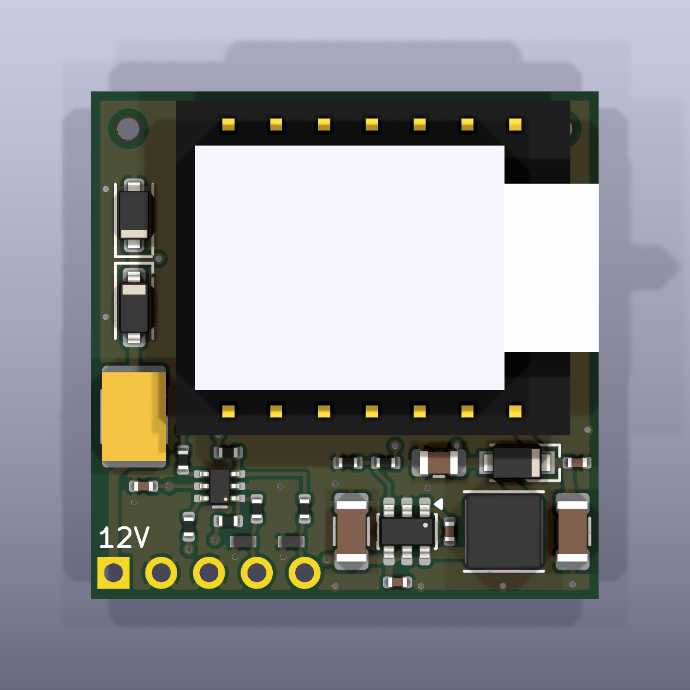

# SolArk XIAO tap carrier, JLC-assembled variant (Rev B, 2026-10-13)

This is a small carrier PCB, assembled by JLCPCB, that replaces the hand-wired
protoboard in [`../../docs/hardware/README.md`](../../docs/hardware/README.md).

It holds:
- a XIAO ESP32S3 Plus, soldered on 2.54 mm male header pins;
- a 12 V to 5 V buck with input protection;
- two **receive-only** Modbus tap inputs, which go through an ESD-protected Schmitt buffer.

Five plated wire holes take the harness: power, ground and both taps.

What changed from Rev A, with verification: [`CHANGES-revB.md`](CHANGES-revB.md).
Cost: [`PRICING.md`](PRICING.md). Before ordering, work through [`OPEN-ITEMS.md`](OPEN-ITEMS.md).

Status: **design complete, not ordered.**
- `kicad-cli sch erc --exit-code-violations`: 0 violations.
- `kicad-cli pcb drc --schematic-parity --exit-code-violations`: 0 violations, 0 unconnected pads, 0 footprint errors.
- The reports are in `fab/erc.rpt` and `fab/drc.rpt`.

| | |
|---|---|
| Board | 27.0 x 27.0 mm, 4 layers, 1.6 mm, JLC04161H-7628 stackup (in the Gerber job file) |
| Assembly | 24 SMD parts, all on the top side, all placed by JLC. There are no DNP parts. |
| Hand-soldered | The XIAO header pins (14), 5 harness wires and the 2 harness 10 k resistors. Parts in the hand-fit kit below. |
| Height (bottom of carrier to top of XIAO) | Spacer slid off, on a Kapton shim (required): about 7.4 mm. Spacer left on: 9.8 mm, over the 9.0 mm limit unless the measured XIAO is lower. See "Mount and height". |



Other renders: `fab/render_bottom.png`, `fab/render_side_front.png`,
`fab/render_side_right.png` and `fab/render_iso.png`.

## SAFETY RULE: 12 V OFF FOR USB

Never plug USB into the XIAO while the harness 12 V is connected. Either:
- unplug the harness (an inline connector in the harness, or the dongle end), or
- use a USB isolator.

This rule is also printed on the bottom silk as "12V OFF FOR USB (or USB isolator)".

The reason:
- D2 does stop USB 5 V from backfeeding the buck.
- But USB ties the laptop ground to the inverter or dongle ground.
- And the harness has no connector on the board, so nothing on the board disconnects it.

Flash the XIAO on the bench.

## Files

| Path | What |
|---|---|
| `carrier.kicad_pro` / `.kicad_sch` / `.kicad_pcb` | KiCad 10 project. The project file holds the design rules (`design.DRC_RULES`), each at least JLC's published 4-layer minimum (`design.JLC_MIN`): annular ring 0.15, clearance 0.15, hole to copper 0.30, hole to hole 0.5, copper to edge 0.3. |
| `scripts/design.py` | **Single source of truth**. It holds the parts, values, LCSC numbers, JLC Basic/Extended status and nets. It also holds every tunable number: header and hole sizes, PTH tolerance, stackup, CPL rotation offsets, the VBUS window and the silk size. |
| `scripts/gen_lib.py` | Project symbols (XIAO, LMR51610, 74LVC2G17), footprints and 3D box models. The footprints are the XIAO header, Nexperia SOT363-2, H5VL10B DFN1006 and the harness wire pads. |
| `scripts/gen_sch.py`, `gen_pcb.py`, `routes.py` | Generate the schematic, placement, stackup, routing, pours and silkscreen |
| `scripts/build.sh`, `export_fab.sh` | Full regeneration plus ERC, DRC, the silk check and fab export. Either script stops with a non-zero exit on a generator error, an ERC violation, a DRC violation or a silk violation. |
| `scripts/silk.py`, `check_silk.py` | JLC legend rules (`design.SILK`): gen_pcb widens every silk stroke to 0.15 mm and trims footprint silk lines back 0.15 mm from pads, holes and the edge; `check_silk.py` writes `fab/silk.rpt` and fails on anything left or a missing pin-1 / cathode mark. |
| `tests/test_design.py` | Invariants (31 tests), covering: <br>- the JLC tooling holes (size, NPTH, mask expansion, edge distance, copper clearance, pours, NPTH drill file); <br>- the silk rules (DRC severities, stroke and text minimums, a clean `fab/silk.rpt` with the pin-1 / cathode marks); <br>- the DRC rules in `carrier.kicad_pro` are at least as strict as JLC's published 4-layer minimums; <br>- the hand-fit kit holds one 10 k per tap wire and a Kapton tape inside the shim range, and every kit part is in this README and PRICING.md; <br>- the tap can reach the GPIO only through the buffer, and the GPIO can never reach the tap; <br>- no TX, proxy or DNP parts; <br>- harness pinout; <br>- the divider's worst-case window; <br>- outline at most 29 x 30; <br>- the XIAO hole fits the pin at JLC tolerance; <br>- no socket parts; <br>- the SOT363 pad ring; <br>- stackup in the job file; <br>- the CPL matches the assembled parts and rotations. |
| `fab/carrier_gerbers.zip` | Gerbers, drill files (`carrier-PTH.drl`, `carrier-NPTH.drl` with the two tooling holes) and job file. The aux origin is the bottom-left corner. |
| `fab/carrier_bom_jlc.csv`, `fab/carrier_cpl_jlc.csv` | JLC BOM (16 lines) and CPL (24 parts, with JLC rotation offsets applied) |
| `fab/carrier_schematic.pdf` | Schematic |

To regenerate, run `sh scripts/build.sh` from this directory (KiCad 10 in `/Applications/KiCad`).
To test, run `../../tools/.venv/bin/pytest -q tests`.

To change the circuit, edit `scripts/design.py` (and `routes.py` for copper). The generators
overwrite the KiCad files.

## Circuit

```
J1.1 +12V -> F1 PPTC 0.5A/60V -> D1 B5819W -> +12V_P [TVS1 SMF18A, C1 10uF/50V, C2 100nF]
+12V_P -> U2 LMR51610 (L1 10uH, C7 22uF, R13 33k 0.1% / R14 6.19k 0.1%) -> +5V_BUCK
+5V_BUCK -> D2 PMEG4030ER -> +5V_X = XIAO 5V pin 14 [C3 100uF, C4 100nF]
J1.4 TAP pad 9  (inverter replies) -> D3 ESD -> R3 1k -> U3 1A (R5 100k to 3V3) -> U3 1Y -> R7 1k -> XIAO D0/GPIO1
J1.5 TAP pad 10 (dongle requests)  -> D4 ESD -> R4 1k -> U3 2A (R6 100k to 3V3) -> U3 2Y -> R8 1k -> XIAO D1/GPIO2
U3 74LVC2G17 VCC = XIAO 3V3 [C9 100nF]
```

### Passive by construction (CLAUDE.md rule 6)

- U3 is one-way. With every footprint fitted, the tests find no path from any XIAO pin to a tap pad.
- No GPIO net connects to any J1 pad (the tests check this).
- No TX, proxy or jumper provision exists any more.

### Input protection

- D3/D4 are H5VL10B ESD diodes: 5 V working, VBR at least 5.6 V, +-25 kV contact.
- R3/R4 limit the current into U3's inputs. U3's inputs are rated to 6.5 V absolute maximum.
- U3 has Ioff, so its pins draw no more than +-2 uA when the XIAO is unpowered [V, Nexperia datasheet].
- Leakage the other way: when the dongle is unpowered but the XIAO is on (USB on the bench), R5/R6 can push up to 3.3 V / 111 k = 30 uA into each dongle UART pin. The path is 100 k + 1 k on board plus the 10 k in the harness. That is harmless, but it is not zero.

### Harness wire pads (J1)

J1 is not a part. It is 5 plated holes: 2.54 mm pitch, 1.0 mm drill, 1.7 mm pad, along the bottom
edge. Silk marks them 12V / G / G / 9 / 10.

| Pad | Signal |
|---|---|
| 1 | +12 V |
| 2 | GND (power) |
| 3 | GND (signal) |
| 4 | TAP pad 9 (inverter replies) |
| 5 | TAP pad 10 (dongle requests) |

Building the harness:
- Insert the wires from the top and solder them on the bottom.
- Glue or tape the wires down for strain relief; see OPEN-ITEMS.
- Put one 10 k series resistor (kit: Stackpole CF14JT10K0, Digi-Key CF14JT10K0CT-ND) in each tap wire, pads 4 and 5, **at the dongle-pad end**, as in the build guide. Solder it inline, as close to the dongle pad as the cavity allows, and cover it with heat-shrink. It limits the current into the dongle's UART pins (the leakage note above counts it) and in an ESD event; the D3/D4 timing (15 pF behind 10 k, 150 ns) also assumes it.
- Keep the inline fuse at the DB9 end.

### Regulator

The regulator is the LMR51610YDBVR (C22427220): 4-65 V input, 70 V absolute maximum, 1 A, 1.1 MHz,
in PFM mode. The values follow the TI design table for 5 V.

Feedback divider:
- R13 33k / R14 6.19k, both 0.1 % 25 ppm, gives Vout = 0.8 x (1 + 33/6.19) = **5.065 V**.
- Worst case before D2 is 5.22 V or less. Worst case at the XIAO pin after D2 is 4.52 V or more.
- The window is 4.40-5.25 V. The arithmetic is in CHANGES-revB.md.

Voltage ratings on the input path:
- F1: 60 V. D1: 40 V. C1: 50 V. U2: 70 V absolute maximum.
- TVS1 (SMF18A) clamps transients. A sustained input above about 20 V makes TVS1 conduct and trips F1.

## Mount and height

The XIAO is soldered on Sullins PRPC040SAAN-RC (or equivalent) headers: 0.64 mm square posts on a
2.50 mm plastic spacer.
- Carrier holes: 1.10 mm drill, 1.70 mm pad. That is 1.02-1.23 mm finished against Sullins' recommended 1.00 mm.
- The XIAO's USB-C faces the right board edge (x = 27 mm).
- No carrier part sits under the XIAO. Only THT pads and tented vias do.

| Option | Stack (tail + carrier + gap + XIAO) | Total |
|---|---|---|
| Spacer left on | 0.8 + 1.6 + 2.5 + 4.9 | 9.8 mm, over the 9.0 mm design limit, within 10 mm |
| Spacer slid off, XIAO on a Kapton shim (0.06-0.2 mm) | 0.8 + 1.6 + 0.06-0.2 + 4.9 | 7.4-7.5 mm |

Pick one of the two; each has a condition you must meet:
- **Spacer off: the Kapton shim is required, not optional.** The carrier's top 1.70 mm header rings clear the XIAO Plus underside pads 15-23 by only 0.049 mm when the XIAO sits flush (VERIFY-revB.md), so bare copper could touch. Lay one layer (0.064 mm) to three layers (0.19 mm) of the kit polyimide tape over both header rows on the carrier top, and push the posts through it. Do not go below one intact layer; above 0.2 mm the stack still fits 9.0 mm but eats the margin left for the unmeasured XIAO height. Each 0.1 mm of shim adds 0.1 mm to the stack.
- **Spacer on: only if the measured height passes.** 9.8 mm is over the 9.0 mm limit with the assumed 4.9 mm XIAO. Use this mount only if the measured XIAO (OPEN-ITEMS 4) makes tail + 1.6 + 2.5 + XIAO at most 9.0 mm, that is, a XIAO of 4.1 mm or less. Otherwise use spacer off with the shim.

Notes on the stack:
- The 4.9 mm XIAO Plus height is inferred and must be measured.
- Trim the tails to 0.8 mm, inside the foam tape (3M 4032, 0.8 mm).
- Trim the posts above the XIAO to the XIAO's tallest part.
- The renders show the spacer-on case. The XIAO and F1 are box models.

Mounting: there is no room for a screw hole, so use foam tape on the bottom "FOAM TAPE" area.

## Hand-fit kit (Digi-Key)

JLC does not supply these; order them separately (`design.KIT`, prices in PRICING.md). Stock read 2026-10-14 [V].

| Part | Digi-Key | Per board | Use |
|---|---|---|---|
| Sullins PRPC040SAAN-RC, 40-pin 2.54 mm header | S1011EC-40-ND | 14 pins | XIAO mount (one strip covers 2 boards) |
| Bertech PPTA-1/2 polyimide (Kapton) tape, 1/2 in x 36 yd, 0.064 mm total | 4393-PPTA-1/2-ND | 1-3 layers | Shim for the spacer-off mount (required) |
| Stackpole CF14JT10K0, 10 k 5 % 1/4 W axial | CF14JT10K0CT-ND | 2 | Harness series resistors, dongle end of each tap wire |

Sources: https://www.digikey.com/en/products/detail/bertech/PPTA-1-2/14670716 (660 in stock, $13.95) and
https://www.digikey.com/en/products/detail/stackpole-electronics-inc/CF14JT10K0/1741265 (571,559 in stock, $0.027 each at 10).
The header line is from PRICING.md (read 2026-10-13).

## Ordering at JLCPCB (after OPEN-ITEMS)

1. Upload `fab/carrier_gerbers.zip` and check that the board reads 27 x 27 mm, 4 layers.
2. Set the board options:
   - quantity 5, 1.6 mm;
   - stackup **JLC04161H-7628**;
   - 1 oz outer and 0.5 oz inner copper;
   - HASL (with lead), or LeadFree HASL if RoHS is wanted (ENIG works but costs more);
   - Via Covering "Plugged" ("Tented" is greyed out for 4-layer).
3. Turn on PCB Assembly:
   - **Economic**, top side, assemble **5** (about $9.74 more than 2; never Standard, which adds edge rails);
   - **Confirm Parts Placement = Yes**;
   - **Tooling holes = "Added by Customer"**. TH1/TH2 are already in the Gerbers: 1.152 mm NPTH
     with 0.148 mm mask expansion, centres 2.0 mm from the top edge and 2.0 mm from the left and
     right edges (`design.TOOLING`). Do not pick "Added by JLCPCB": JLC's own holes go on
     opposite corners, which on this board can put one at the bottom-left, on J1 pad 1 (+12V_IN). The two holes are on
     the top corners (JLC's page asks for "opposite corners", not "diagonal"); the bottom corners
     hold J1 and C3. If JLC's review objects, reply before letting them move the holes.
4. Upload the BOM and CPL. Check the 16 LCSC lines against CHANGES-revB.md.
5. In the placement preview, check each polarized part:

   | Part | Correct orientation |
   |---|---|
   | U2 | Pin 1 (CB) is at C8 |
   | U3 | Pin 1 (1A) is at R3/R5 |
   | D1, D2, TVS1 | The cathode bands match `fab/render_top.png` |
   | D3, D4 | Bidirectional, so orientation does not matter |

   The CPL rotation offsets are inferred; see OPEN-ITEMS.

## Bring-up

1. Inspect the bands, U2 pin 1 and U3 pin 1 against the renders.
2. Bench test with no XIAO fitted:
   - Apply 12 V to pads 1 and 2 from a supply limited to 100 mA.
   - Check that C7 reads 4.96-5.22 V and C3 reads about 4.6-4.9 V.
   - Reverse the polarity: it should draw no current.
3. Solder the header to the XIAO. For the spacer-off mount (the default), slide the spacer off and lay the Kapton shim (1-3 layers of the kit tape) over both header rows on the carrier top; never fit the XIAO flush on bare copper.
4. Fit the XIAO with USB-C at the right edge. Solder it and trim the tails.
5. Solder the harness to pads 1-5, with a 10 k at the dongle end of the pad 4 and pad 5 wires. Check continuity, and that each tap wire reads about 10 k from its dongle end to its J1 pad, before connecting it to the dongle.
6. Remember the **12 V OFF FOR USB** rule.

## Verified vs inferred

Every part claim, with its URL, is in CHANGES-revB.md (parts table). What is still inferred:
- the XIAO Plus height;
- the CPL rotation offsets;
- PPTC hold-current derating at 60 C (about 0.375 A against at least 0.3 A needed);
- the land patterns of the kept Rev A parts (not re-read in Rev B).

These are listed in OPEN-ITEMS.md.

## Known risks

1. **No on-board disconnect.** The harness is soldered in. Add an inline connector in the harness if you need to unplug it easily (OPEN-ITEMS 1).
2. **The on-board PPTC does not protect the harness.** Keep the inline fuse at the DB9 end.
3. **Overvoltage above about 18-20 V.** If the 12 V rail can legitimately exceed about 17 V, move TVS1 to SMF24A and re-check D1.
4. **Tap logic level.** The tests assume the dongle's UT3232G TTL side is 5.5 V or less, which matches the D3/D4 VBR minimum of 5.6 V and U3's 5.5 V operating maximum. Measure it (OPEN-ITEMS).
5. **Tape is the only mechanical fixing.**
