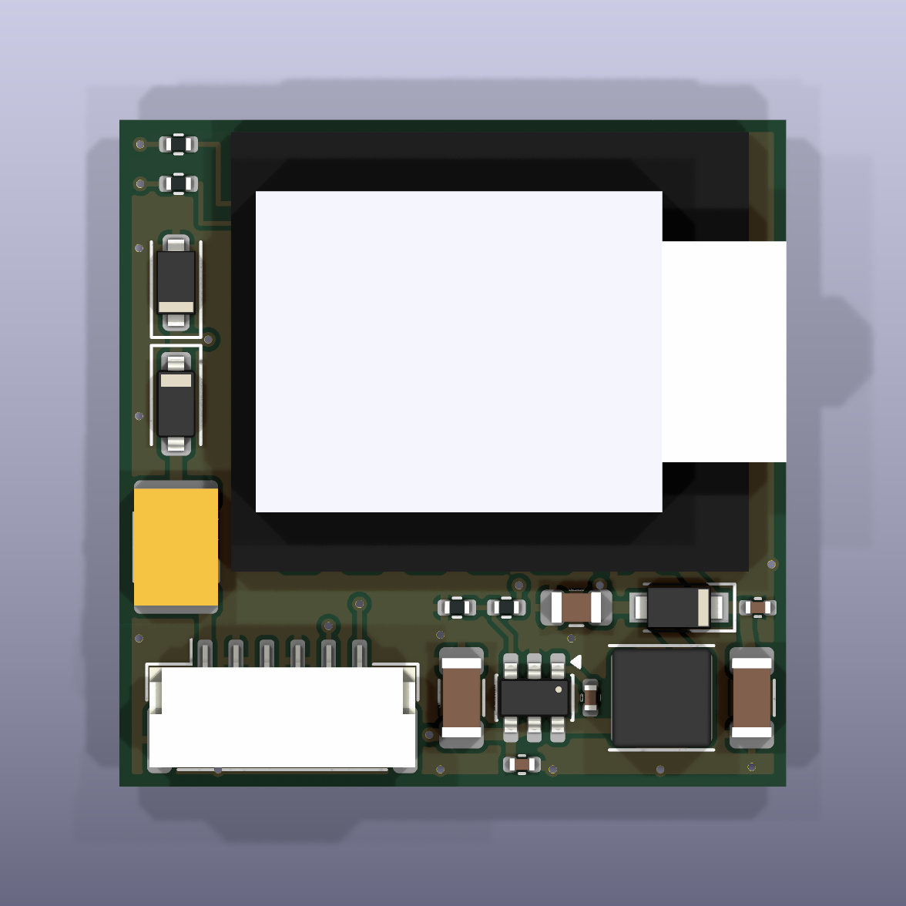

# SolArk XIAO tap carrier (Rev A, 2026-10-12)

This is a small carrier PCB, assembled by JLCPCB, that replaces the
hand-wired protoboard in [`../../docs/hardware/README.md`](../../docs/hardware/README.md).
It holds a removable XIAO ESP32S3 Plus, a 12 V to 5 V buck regulator with input
protection, and the two passive Modbus tap inputs. One latching 6-pin harness
connector carries power and both taps.

Status: **design complete, not ordered.**
- `kicad-cli sch erc`: 0 violations, warnings included.
- `kicad-cli pcb drc --schematic-parity`: 0 violations, 0 unconnected items and 0 parity issues, warnings included.

The reports are in `fab/erc.rpt` and `fab/drc.rpt`.

Five DRC checks are left at KiCad's default severity of "ignore":
- `missing_courtyard`: every footprint here has a courtyard, including the custom XIAO one, so courtyard overlap is still checked.
- `footprint_filters_mismatch` and `footprint_type_mismatch`: cosmetic. The XIAO footprint is intentionally set to through-hole and excluded from the BOM.
- `track_not_centered_on_via`: cosmetic.
- `tuning_profile_track_geometries`: no length-tuned nets.

| | |
|---|---|
| Board | 27.0 x 27.0 mm, 4 layers, 1.6 mm FR-4 |
| Assembly | All SMD parts on the top side, assembled by JLCPCB. The bottom side holds only DNP footprints and bare pads. |
| Hand-soldered | 14 Mill-Max receptacles, the XIAO header pins, and the harness |
| Height | 7.6 mm socketed (8.4 mm with 1.6 mm foam tape) and 6.6 mm flat-soldered, against a 9.0 mm design limit (10 mm envelope) |



Bottom view: `fab/render_bottom.png`. Side views: `fab/render_side_front.png` and
`fab/render_side_right.png`. Isometric view: `fab/render_iso.png`.

## Files

| Path | What |
|---|---|
| `carrier.kicad_pro` / `.kicad_sch` / `.kicad_pcb` | KiCad 10 project. Design rules are in the project file (JLCPCB 4-layer capability). |
| `scripts/design.py` | **Single source of truth**: parts, values, LCSC numbers, DNP flags and nets |
| `scripts/gen_lib.py` | Project symbols (XIAO, LMR51610), the XIAO footprint, and 3D box models |
| `scripts/gen_sch.py`, `scripts/gen_pcb.py`, `scripts/routes.py` | Generate the schematic, then the placement, routing, pours and silkscreen |
| `scripts/build.sh` | Full regeneration plus ERC, DRC and every fab export |
| `tests/test_design.py` | Netlist invariants: passive-only taps, proxy path not populated, LCSC numbers, harness pinout, Vout |
| `lib/` | Project libraries. `lib/seeed/` holds the untouched Seeed reference files (CC BY-SA 4.0, see `lib/seeed/LICENSE`). |
| `fab/carrier_gerbers.zip` | Gerbers, Excellon drill file and drill map (aux origin = bottom-left corner) |
| `fab/carrier_bom_jlc.csv` | JLC BOM: Comment, Designator, Footprint, LCSC Part #. DNP parts and parts JLC does not fit are excluded. |
| `fab/carrier_cpl_jlc.csv` | JLC CPL: Designator, Mid X, Mid Y, Layer, Rotation. Same origin as the Gerbers. |
| `fab/carrier_schematic.pdf` | Schematic |

To regenerate everything, run `sh hardware/carrier/scripts/build.sh`. It needs KiCad 10 in
`/Applications/KiCad`. To run the tests, use `tools/.venv/bin/pytest hardware/carrier/tests`.

The schematic is generated in label style: every pin carries a net label, so there are no wires.
To change the circuit, edit `scripts/design.py` (and `routes.py` for copper), not the KiCad
files. The generator overwrites the KiCad files.

## Circuit

```
J1.1 +12V -> F1 PPTC 0.5A/60V -> D1 B5819W -> +12V_P [TVS1 SMF18A, C1 10uF/50V, C2 100nF]
  -> U2 LMR51610 (EN tied to VIN, 1.1 MHz) -> L1 10uH -> +5V_BUCK [C7 22uF, R13 27k / R14 5.1k]
  -> D2 PMEG4030ER (backfeed block) -> +5V_X [C3 100uF, C4 100nF] -> XIAO 5V (pin 14)

J1.5 TAP pad 9  (inverter replies)  -> R3 1k -> XIAO D0/GPIO1 (pin 1)  [R5 100k to 3V3 DNP, C5 100pF DNP]
J1.6 TAP pad 10 (dongle requests)   -> R4 1k -> XIAO D1/GPIO2 (pin 2)  [R6 100k to 3V3 DNP, C6 100pF DNP]
XIAO D9/GPIO8 (pin 10) -> R12 1k DNP -> JP1 open jumper -> TP1 pad   "DNP: proxy only"
```

Notes on the circuit:
- **Passive only.**
  - Each tap reaches the XIAO through two series resistors: the off-board 10 k in the harness (unchanged from the build guide) and the on-board 1 k.
  - No default-populated part connects any XIAO pin to anything else on the link.
  - The proxy reservation (R12, JP1, TP1) sits on the bottom side and is not wired to J1. Using it needs a wire, a fitted R12, a bridged JP1 and an approved proxy-mode change.
  - `tests/test_design.py` enforces all of this.
- **Feedback divider:** Vout = 0.8 V x (1 + 27k / 5.1k) = 5.04 V.

**Harness connector J1** is a JST GH 1.25 mm, 6-pin, horizontal SMD part: latching, keyed, 4.25 mm tall.

| Pin | Signal |
|---|---|
| 1 | +12 V |
| 2 | GND (power) |
| 3 | spare, NC |
| 4 | GND (signal) |
| 5 | TAP pad 9 |
| 6 | TAP pad 10 |

- GH is rated 1 A per pin with 26-30 AWG wire. The worst-case input current is about 0.25 A at 12 V (5.04 V x 0.45 A / 85 % / 11.4 V), so 4x margin.
- This pin order differs from the protoboard P1 in the build guide (there pin 3 was the key). Re-pin the harness to match.

## Regulator decision: on-board TI LMR51610, not the Pololu D24V10F5

The Pololu module does not fit the 27 x 27 x 9 mm envelope.

| Option | Result |
|---|---|
| Pololu beside the XIAO | Needs 17.8 + 12.7 = 30.5 mm across. Over the 27 mm limit. |
| Pololu stacked under the carrier | 3.8 (module) + 1.6 + 0.3 + 4.9 = 10.6 mm. Over the 9.0 mm limit. |
| Pololu bridged over carrier parts | Only 0.84 mm of clearance under the module. Not usable. |

Measured Pololu module: 12.7 x 17.8 mm, PCB 1.02 mm, parts 2.8 mm.

Chosen part: **LMR51610YDBVR**, LCSC C22427220.
- Ratings: 4-65 V operating, 70 V absolute maximum, 1 A, SOT-23-6.
- Values follow the datasheet design table for 5 V at 1.1 MHz: 10 uH and at least 10 uF output.
- Input capacitance is 10 uF plus 100 nF (the datasheet asks for at least 2.2 uF).
- CB uses 100 nF to SW. EN is tied to VIN.

Layout follows the datasheet guidance:
- C2 (100 nF) sits directly at the VIN/EN pins with its own ground via. C1 is 2 mm away.
- The SW node is a 0.6 mm stub of about 2.7 mm from U2 to L1. The inductor and switch node are at the USB end, away from the U.FL.
- The FB divider sits at the FB pin and is routed away from SW. The top resistor senses at the output capacitor C7, through an inner-layer link.
- The return path uses the solid In1 GND plane plus top and bottom GND pours.
- Compromise: the FB trace passes between C1's ground pad and the U2 GND pin, so C1's ground returns through vias to In1, not over a top-layer path. At under 0.3 A input this is acceptable.

Margin at 450 mA load:
- Worst-case Vout is about 4.91 V (Vref and 1 % resistor tolerance).
- The D2 drop is at most about 0.45 V.
- That leaves VBUS of at least about 4.46 V, which meets the 4.4 V requirement.
- Inductor ripple is about 0.27 A peak-to-peak at 12 V. The peak current limit is 1.25-1.95 A and L1 saturates at 2.4 A.

Voltage ratings along the input path:

| Part | Rating |
|---|---|
| F1 | 60 V |
| D1 | 40 V |
| C1 | 50 V |
| U2 | 70 V absolute maximum |

The TVS (18 V standoff, 29 V clamp) protects against transients. A sustained input above about 20 V makes TVS1 conduct and trips F1.

## XIAO mount decision: Mill-Max low-profile receptacles (removable)

The footprint `carrier:XIAO_ESP32S3_Socket_SMD` supports both mounting options on the same board:
- 14 plated holes, 1.52 mm drill with a 2.0 mm pad, for **Mill-Max 7305-0-15-15-47-27-10-0** press-fit receptacles. They accept pins of 0.64-0.94 mm.
- Overlapping castellation pads (1.52 x 1.85 mm) for **soldering the XIAO flat**, using the pin positions from Seeed's XIAO-ESP32-S3-DIP footprint.

For the socketed option:
- Solder standard 0.64 mm square male header pins into the XIAO.
- Pull off the plastic spacer and trim the pins to about 2.0 mm below the XIAO.
- Plug the XIAO into the receptacles.

The XIAO's USB-C face sits flush with the right board edge (silk "USB" on the bottom). Nothing on the carrier sits under the XIAO except tented copper.

### Height stack-up

| Layer | Socketed | Flat SMT |
|---|---|---|
| Receptacle tails below the carrier [I] (2.67 total - 0.3 flange - 1.6) | 0.77 | 0 |
| Carrier PCB | 1.60 | 1.60 |
| Receptacle flange or solder gap [I] | 0.30 | 0.10 |
| XIAO ESP32S3 Plus including USB-C [I: Seeed outline plus vendor "5 mm"] | 4.90 | 4.90 |
| **Total** | **7.57** | **6.60** |
| With 0.8 mm foam tape (3M 4032) replacing the tail height | 7.60 | 7.40 |
| With 1.6 mm foam tape (3M 4026) | 8.40 | 8.20 |

- Every option meets the 9.0 mm design limit, which allows 1 mm of margin inside the 10 mm envelope.
- Other tall parts sit below the XIAO top: J1 at 4.25 mm, L1 at 3.0 mm, and F1 at 1.8 mm or less.
- The mated U.FL plug sits about 2.5 mm above the XIAO PCB, which is still lower than the USB-C top.
- The side renders show the stack. The XIAO and the 1812 fuse are **approximate box models** (`lib/3d/*.wrl`), because no accurate STEP model was available. The Seeed STEP covers the Sense variant.

Mounting: the board has no room for an M2 hole. Use foam tape on the bottom "FOAM TAPE AREA". Use 0.8 mm tape to keep the stack at 7.6 mm.

U.FL: the XIAO Plus antenna is external. The pigtail leaves the U.FL near the left end of the XIAO and exits over the left edge, above F1, D1 and TVS1, which are all 1.8 mm tall or less. See the outline on the User.Drawings layer. Keep the antenna itself away from the inverter chassis and the dongle's own antenna.

## Parts

### JLCPCB-assembled (top side)

Stock was checked against the JLCPCB parts API on 2026-10-12. "Ext" means extended, which adds about $3 per unique part.

| Ref | Part | Package | LCSC | Type | Stock |
|---|---|---|---|---|---|
| U2 | TI LMR51610YDBVR | SOT-23-6 | C22427220 | Ext | 3,160 |
| L1 | Changjiang FNR4030S100MT 10 uH, 2.4 A sat | 4x4x3 mm | C167879 | Ext | 106,079 |
| F1 | SMD1812P050TF/60 PPTC 0.5 A hold, 60 V | 1812 | C462518 | Ext | 5,005 |
| D1 | B5819W 40 V 1 A Schottky | SOD-123 | C8598 | Basic | 393,009 |
| TVS1 | SMF18A unidirectional TVS | SOD-123F | C123787 | Ext | 35,032 |
| D2 | Nexperia PMEG4030ER 40 V 3 A Schottky | SOD-123W | C389355 | Ext | 11,286 |
| C1 | 10 uF 50 V X5R | 1206 | C13585 | Basic | 2.2 M |
| C2, C4, C8 | 100 nF 50 V X7R | 0402 | C307331 | Basic | 15 M |
| C3 | 100 uF 6.3 V X5R | 1206 | C15008 | Basic | 1.7 M |
| C7 | 22 uF 25 V X5R | 0805 | C45783 | Basic | 3.6 M |
| R3, R4 | 1 k 1 % | 0402 | C11702 | Basic | 8 M |
| R13 | 27 k 1 % | 0402 | C25771 | Ext | 206,510 |
| R14 | 5.1 k 1 % | 0402 | C25905 | Basic | 5.5 M |
| J1 | XYECONN XY-SM06B-GHS-TB (GH-compatible) | 1.25 mm 6P RA SMD | C51940119 | Ext | 11,463 |

DNP footprints, not in the BOM or CPL:
- On the bottom side: R5 and R6 (100k, C25741), C5 and C6 (100 pF, C1546), and R12 (1k, C11702).
- JP1 (open solder jumper) and TP1 are bare copper.

### Hand-soldered (through-hole) and harness

| Qty | Part | Link |
|---|---|---|
| 14 | Mill-Max 7305-0-15-15-47-27-10-0 press-fit receptacle (0.64-0.94 mm pins), plus 2 spares | [Digi-Key](https://www.digikey.com/en/products/detail/mill-max-manufacturing-corp/7305-0-15-15-47-27-10-0/1765737) / [Mouser](https://www.mouser.com/c/?q=7305-0-15-15-47-27-10-0) |
| 1 | 2.54 mm male header, 0.64 mm square pins, for the XIAO (for example Sullins PRPC040SAAN-RC) | [Digi-Key](https://www.digikey.com/en/products/result?keywords=PRPC040SAAN-RC) / [Mouser](https://www.mouser.com/c/?q=PRPC040SAAN-RC) |
| 1 | JST GHR-06V-S housing (6P, 1.25 mm) | [Digi-Key](https://www.digikey.com/en/products/result?keywords=GHR-06V-S) / [Mouser](https://www.mouser.com/c/?q=GHR-06V-S) |
| 6 | JST SSHL-002T-P0.2 crimp contacts (26-30 AWG), or pre-crimped GH leads | [Digi-Key](https://www.digikey.com/en/products/result?keywords=SSHL-002T-P0.2) / [Mouser](https://www.mouser.com/c/?q=SSHL-002T-P0.2) |
| 1 | Foam tape, 3M 4032 (0.8 mm) or 3M 4026 (1.6 mm) | [Digi-Key](https://www.digikey.com/en/products/result?keywords=3M%204032) |

The harness keeps the build guide's off-board **10 k series resistors** at the dongle end and the inline fuse at the DB9 end. See the risks below.

## Ordering at JLCPCB (do not order until the checks below are done)

1. Upload `fab/carrier_gerbers.zip`. The board should detect as 27 x 27 mm, 4 layers.
2. PCB options:

   | Option | Setting |
   |---|---|
   | Quantity | 5 |
   | Thickness | 1.6 mm |
   | Stackup | JLC default 4-layer (JLC04161H-7628) |
   | Outer copper | 1 oz |
   | Inner copper | 0.5 oz |
   | Surface finish | **ENIG** (flat pads for 0402/SOT-23 and a consistent hole size for the press-fit receptacles; lead-free HASL also works) |
   | Via covering | Tented (the Gerbers already tent vias) |
   | Mark on PCB | Remove, or let JLC place it |

3. Turn on **PCB Assembly**:
   - Choose Economic if the quote offers it for 4 layers, otherwise Standard.
   - Assemble the **top side** only.
   - Quantity 5, or 2 to save parts cost.
   - Set **"Confirm Parts Placement" = Yes**.
4. Upload `fab/carrier_bom_jlc.csv` and `fab/carrier_cpl_jlc.csv`. Check that all 14 BOM lines match the LCSC numbers above and are in stock.
5. **JLC rotation check.** The CPL holds KiCad's rotations unchanged, and JLC's footprint zero differs for some packages. In the placement preview:

   | Part | What to check |
   |---|---|
   | U2 (SOT-23-6, 270 deg) | The pin-1 dot sits at the pad next to the silk triangle, top right. Pin 1 is CB and connects to C8. Likely needs a +180 or -90 deg correction if it is wrong. |
   | D1 | The cathode band points up, toward TVS1. |
   | TVS1 | The cathode band points down, toward D1. |
   | D2 | The cathode band points right, toward C4. |
   | J1 | The mating opening faces the bottom board edge. |

   L1, C and R parts are not polarized. Fix any mismatch with JLC's rotate tool, or with "Confirm Parts Placement" before production.

**Cost estimate for 5 boards, all 5 assembled.** These figures are not a quote.

| Item | Cost |
|---|---|
| PCB | about $7-10 |
| Assembly setup | $8 (Economic) or about $25 (Standard) |
| Stencil | about $1.5-7 |
| Extended-part fees | 7 x $3 = $21 |
| Parts | about $8-10 for 5 sets, roughly $1.5-2 per board, mostly U2 and J1 |
| **Total** | **about $45-55 with Economic assembly, or $65-75 with Standard**, before shipping, tax and the hand-solder parts (about $15) |

Replacing R13 (27 k, extended) with a basic-library value saves $3. No basic-library pair gives exactly 5.0 V, so it stays.

## Assembly order (after the boards arrive)

1. Inspect the boards: diode band orientation, U2 pin 1, and the J1 orientation against the renders.
2. Bench test with no XIAO fitted:
   - Feed 12 V through J1 pins 1 and 2 from a current-limited supply set to 100 mA.
   - Check 5.0 V (±0.13 V) at C7 and about 4.7-4.9 V at C3 / XIAO pin 14.
   - Check reverse polarity: J1 pins swapped should draw no current.
3. Press the 14 receptacles into the holes from the top. Solder them from the bottom. Keep the tails short and flush. The tails set the bottom height (0.77 mm).
4. Prepare the XIAO: solder the header pins, remove the plastic, and trim the pins to about 2.0 mm.
5. Fit the XIAO with USB-C at the board edge marked "USB". Re-check 5 V at XIAO pin 14 under load.
6. Crimp the harness to the J1 pinout above, with the 10 k resistors at the dongle end and the inline fuse at the DB9 end. Check continuity before connecting to the dongle.
7. **Never connect USB while the board is installed** unless a USB isolator is fitted (silk on the bottom). Flash the XIAO on the bench.

## Verified vs inferred

**Verified**, from primary sources or tool output in this session:
- ERC, DRC and parity are clean.
- The LCSC numbers, stock levels and basic/extended status.
- The LMR51610 pinout, ratings and design table, from the TI datasheet.
- Pololu dimensions, from the Pololu drawing.
- XIAO pin positions and outline (2.54 mm pitch, rows at ±7.62 mm, 17.8 x 21 mm, USB-C overhang to +12.065 mm), from Seeed's KiCad footprints.
- Mill-Max 7305: 2.67 mm length, 1.52 mm mounting hole and 0.64-0.94 mm pin range, from the Digi-Key and Mill-Max listings.
- The GH 1 A per pin rating, from the LCSC listing for C51940119.
- KiCad footprints exist for every part.

**Inferred**, to verify:
- XIAO ESP32S3 Plus total height of 4.9 mm. No Plus STEP model was found, and the USB-C height (UBF31-0171, about 3.3 mm) is unverified.
- The Mill-Max flange thickness (0.3 mm), and therefore the tail length (0.77 mm).
- PPTC hold current at 60 °C of about 0.375 A, from typical PPTC derating. The requirement is at least 0.3 A. Confirm with the SMD1812P050TF/60 derating table.
- PMEG4030ER forward voltage at 0.45 A of 0.45 V or less.
- That the XY-SM06B-GHS-TB clone mates with genuine JST GHR-06V-S housings. Genuine JST SM06B-GHS-TB had zero JLC stock.
- Pad compatibility of the stock KiCad footprints for the XY GH clone and the FNR4030S inductor. Both use the manufacturers' land patterns.
- The U.FL position on the XIAO Plus (Seeed Plus PCB, about (-8.75, -4.84) mm from the XIAO centre).

## Known risks

1. **The harness exits beyond the board edge.** The mated GH plug and its wires extend past the bottom edge, roughly 3-6 mm plus the cable bend radius. The 28 x 28 mm envelope covers the board but not the plug. Confirm there is clearance in the dongle enclosure.
2. **The on-board PPTC does not protect the harness.** Keep the inline fuse at the DB9 end so a short in the harness itself is protected.
3. **Overvoltage above about 18-20 V.** TVS1 starts to conduct and F1 trips (resettable). If the DB9 12 V rail can legitimately exceed about 17 V, change TVS1 to SMF24A or SMF33A and re-check the D1 rating.
4. **Stack height depends on the inferred XIAO height and tail length.** There is 1.4 mm of margin at the 9.0 mm limit with 0.8 mm tape. Measure a real XIAO Plus before ordering.
5. **4-layer boards may require Standard PCBA.** If so, assembly costs about $20 more. A 2-layer re-layout would allow Economic assembly but loses the solid ground plane.
6. **The bottom-side DNP parts (R5/R6/C5/C6/R12) are hand-fit only.** They are 0402s if they are ever needed. They sit inside the tail height, so they do not change the stack.
7. **No mechanical fixing other than tape.** There is no room for an M2 hole.
8. **USB backfeed.** D2 blocks the XIAO's USB 5 V from reaching the buck. Plugging USB into an installed board still ties the laptop ground to inverter ground. Use an isolator.
